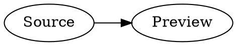
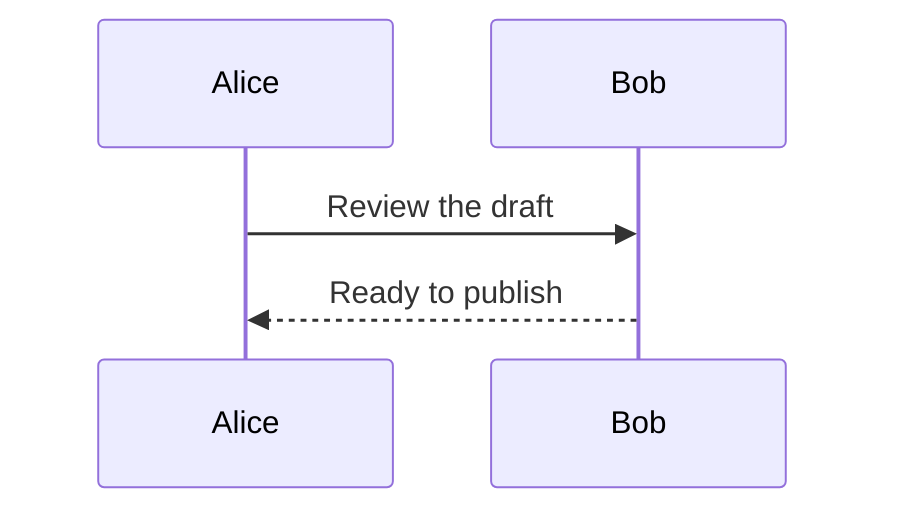
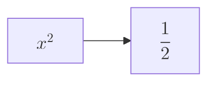

# Diagram notebook

Enable Mermaid and Graphviz in Markdown settings to render these offline examples.

The source stays ordinary Markdown. HTML/PDF/print carry rendered diagrams without
running Mermaid or Graphviz in the exported document.
